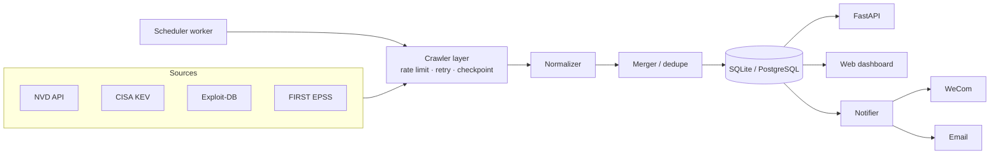

<div align="center">

# VulPulse

**Open-source vulnerability intelligence platform**

Collect · Normalize · Deduplicate · Score · Alert


</div>

VulPulse aggregates public vulnerability data from sources such as NVD, CISA KEV,
Exploit-DB and FIRST EPSS. It normalizes records into a single model, deduplicates
them across sources, enriches them with exploit intelligence, and exposes the
result through a REST API, a web dashboard, and configurable alerts
(WeCom / email).

> **Status:** early development (`v0.1.0` in progress). The API and database
> schema may change before `v1.0`.

## Why VulPulse

Vulnerability information is scattered across dozens of sites with different
formats, identifiers and update cadences. Security teams and researchers end up
checking NVD, vendor advisories, KEV and exploit feeds by hand.

VulPulse turns that into one pipeline:

- **One model** — CVE-centric records with CVSS, CWE, affected products, EPSS,
  KEV status and exploit availability.
- **One source of truth** — every field keeps a link back to the raw records it
  came from, so merges are auditable.
- **One place to watch** — filter by severity, vendor, product or keyword and
  get alerts only for what matters.

## Architecture



The scheduler runs in its own process (`vulpulse worker`), separate from the API,
so multiple API workers can never trigger duplicate crawls.

## Roadmap

| Phase | Scope | Status |
|---|---|---|
| **M0** | Repository scaffolding, lint, tests, CI, license | ✅ |
| **M1** | Configuration, structured logging, CLI entry point | ✅ |
| **M2** | Database models, migrations, repositories | ✅ |
| **M3** | Crawler framework: source base class, registry, rate limiting, retries | ✅ |
| **M4** | NVD + CISA KEV ingestion with idempotent upserts | ✅ |
| **M5** | Exploit-DB + EPSS enrichment | 🗓 |
| **M6** | Scheduler worker and crawl run history | 🗓 |
| **M7** | REST API: vulnerabilities, statistics, sources | 🗓 |
| **M8** | Web dashboard | 🗓 |
| **M9** | Subscription rules and WeCom / email alerts | 🗓 |
| **M10** | Docker packaging, demo data, `v0.1.0` release | 🗓 |

Phase 2 adds a configurable 0–100 risk score, vendor/product correlation,
user-defined subscriptions, export to Markdown/HTML and stronger rate control.
Phase 3 adds a vulnerability graph, optional LLM summaries and a plugin system
for additional sources.

## Quickstart (development)

```bash
git clone <your-repo-url> VulPulse
cd VulPulse

python -m venv .venv
# Windows: .venv\Scripts\activate
# Linux/macOS: source .venv/bin/activate

pip install -e ".[dev]"
cp .env.example .env

pytest
ruff check .
vulpulse init-db
vulpulse sources
vulpulse crawl --source cisa_kev --since-days 1
vulpulse crawl --source nvd --since-days 7
vulpulse version
```

`vulpulse crawl` writes to the SQLite database and records every run in
`crawl_runs`. Re-running a source is idempotent: records are merged by CVE,
not duplicated.

Python 3.10+ is required. The default database is SQLite, so no external
services are needed.

## Configuration

All settings use the `VULPULSE_` prefix and can be provided via environment
variables or `.env`. See [`.env.example`](.env.example) for the full list.

| Variable | Default | Purpose |
|---|---|---|
| `VULPULSE_ENV` | `dev` | `dev`, `test` or `prod` |
| `VULPULSE_LOG_LEVEL` | `INFO` | Console/file log level |
| `VULPULSE_DATABASE_URL` | `sqlite+aiosqlite:///./data/vulpulse.db` | SQLAlchemy URL |
| `VULPULSE_API_KEY` | empty | Protects admin endpoints |
| `VULPULSE_NVD_API_KEY` | empty | Raises NVD rate limit from 5 to 50 req/30s |
| `VULPULSE_WECOM_WEBHOOK_URL` | empty | WeCom alert channel |
| `VULPULSE_SMTP_*` | empty | Email alert channel |

Never commit `.env`.

## Data sources and compliance

VulPulse only collects **publicly accessible** vulnerability metadata. It does
not provide proof-of-concept code, exploit tooling, or attack capabilities.

- Requests are rate-limited and identify the client via `User-Agent`.
- No login, CAPTCHA, paywall or access-control bypass is implemented.
- Raw records are stored for auditability; source terms and licenses remain with
  their respective owners. The MIT license covers VulPulse code only.
- Chinese sources such as CNVD are not enabled by default because they lack
  stable public APIs and have unclear scraping terms. Any future adapter will be
  opt-in and disabled by default.

See the [disclaimer](#disclaimer) below.

## Project layout

```
vulpulse/
├── crawler/      # source adapters, HTTP client, raw models
├── analyzer/     # normalization, merging, scoring
├── db/           # SQLAlchemy models, sessions, repositories
├── notifier/     # subscription rules and delivery channels
├── scheduler/    # APScheduler jobs and worker entry point
├── api/          # FastAPI application and routers
├── web/          # Jinja2 templates and static assets
├── config.py     # environment-driven settings
├── logging.py    # loguru configuration
└── cli.py        # Typer entry point
```

## Contributing

Issues and pull requests are welcome. Please run `ruff check .`,
`ruff format --check .` and `pytest` before opening a PR. Commit messages follow
[Conventional Commits](https://www.conventionalcommits.org/) (`feat:`, `fix:`,
`docs:`, ...).

## Disclaimer

VulPulse is intended for defensive security research and vulnerability
management. It aggregates publicly available information and does not perform
scanning or exploitation. Users are responsible for complying with the terms of
service of every data source and with applicable laws and regulations. The
maintainers are not liable for misuse.

## License

[MIT](LICENSE)
