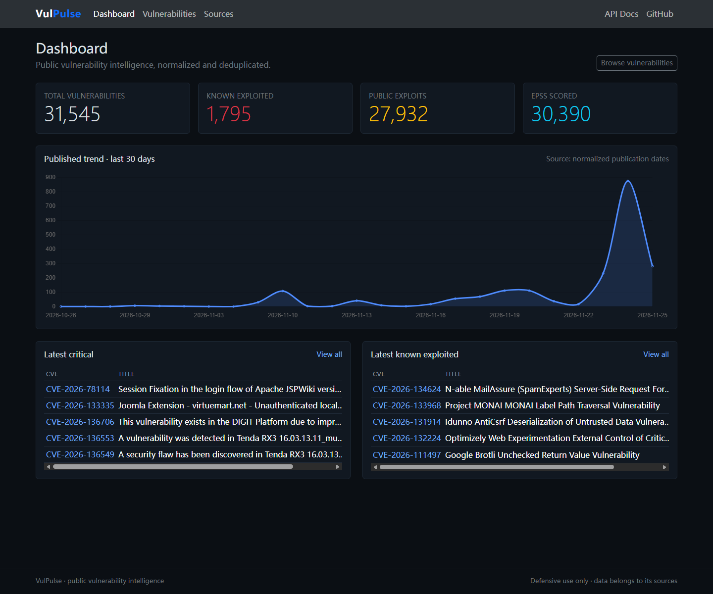
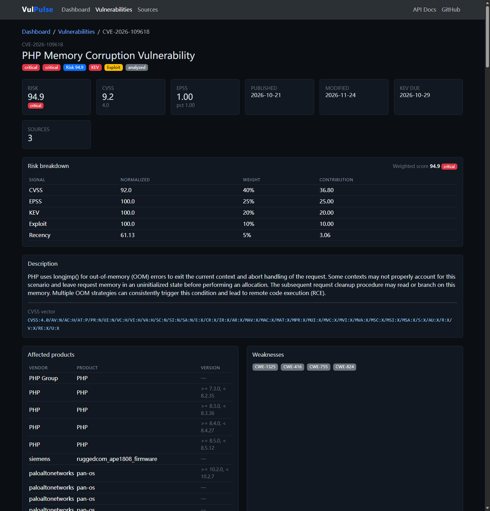
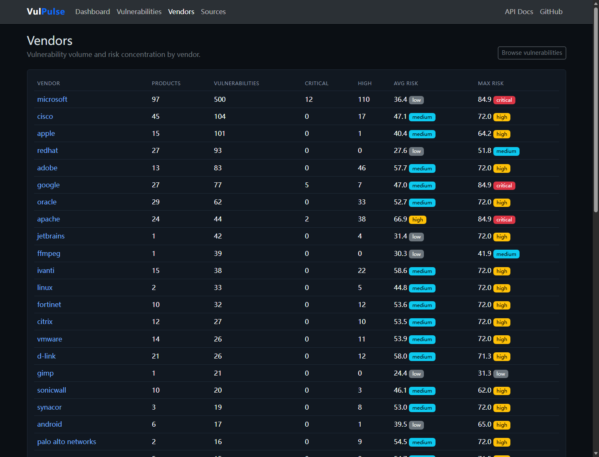
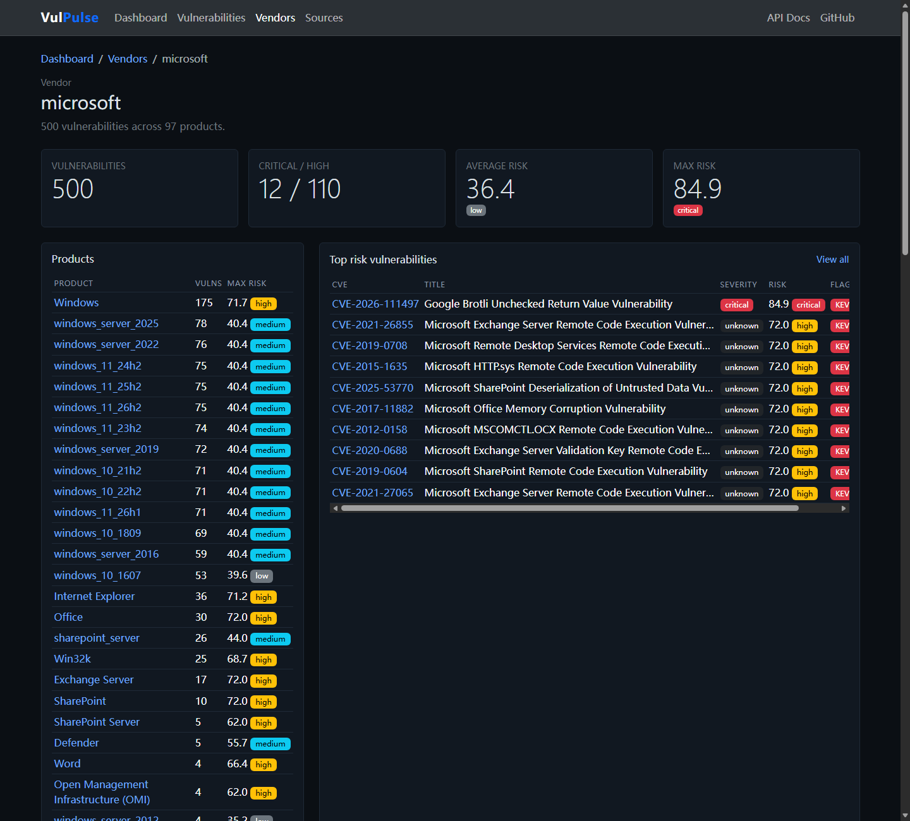
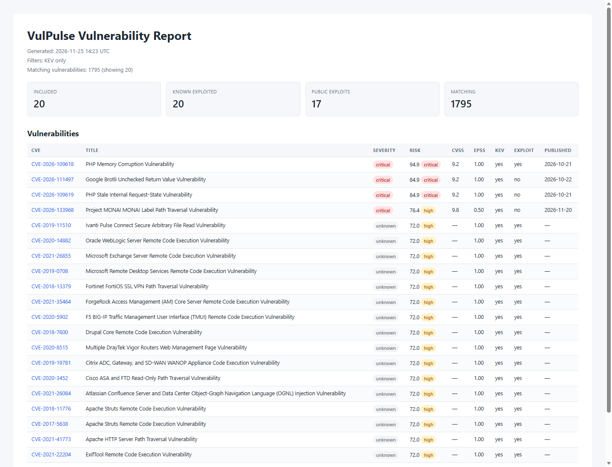
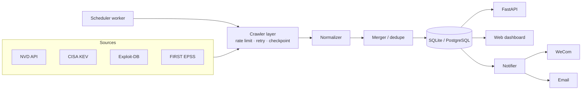

<div align="center">

# VulPulse

**Open-source vulnerability intelligence platform**

Collect · Normalize · Deduplicate · Score · Alert

[](https://github.com/1233223z/VulPulse/actions/workflows/ci.yml)


</div>

VulPulse aggregates public vulnerability data from sources such as NVD, CISA KEV,
Exploit-DB and FIRST EPSS. It normalizes records into a single model, deduplicates
them across sources, enriches them with exploit intelligence, and exposes the
result through a REST API, a web dashboard, and configurable alerts
(WeCom / email).

> **Status:** `v0.5.3`. The API and database schema may change before `v1.0`.

## Screenshots












Screenshots use 31k+ real records collected by VulPulse from NVD, CISA KEV,
Exploit-DB and FIRST EPSS.

## Why VulPulse

Vulnerability information is scattered across dozens of sites with different
formats, identifiers and update cadences. Security teams and researchers end up
checking NVD, vendor advisories, KEV and exploit feeds by hand.

VulPulse turns that into one pipeline:

- **One model** — CVE-centric records with CVSS, CWE, affected products, EPSS,
  KEV status and exploit availability.
- **One source of truth** — every field keeps a link back to the raw records it
  came from, so merges are auditable.
- **One place to watch** — filter by severity, vendor, product or keyword and
  get alerts only for what matters.

## Architecture



The scheduler runs in its own process (`vulpulse worker`), separate from the API,
so multiple API workers can never trigger duplicate crawls.

## Roadmap

| Phase | Scope | Status |
|---|---|---|
| **M0** | Repository scaffolding, lint, tests, CI, license | ✅ |
| **M1** | Configuration, structured logging, CLI entry point | ✅ |
| **M2** | Database models, migrations, repositories | ✅ |
| **M3** | Crawler framework: source base class, registry, rate limiting, retries | ✅ |
| **M4** | NVD + CISA KEV ingestion with idempotent upserts | ✅ |
| **M5** | Exploit-DB + EPSS enrichment | ✅ |
| **M6** | Scheduler worker and crawl run history | ✅ |
| **M7** | REST API: vulnerabilities, statistics, sources | ✅ |
| **M8** | Web dashboard | ✅ |
| **M9** | Subscription rules and WeCom / email alerts | ✅ |
| **M10** | Docker packaging and `v0.1.0` release | ✅ |

Phase 2 adds a configurable 0-100 risk score (done), vendor/product correlation
(done), Markdown/HTML reports (done), a subscription management UI (done) and
API rate limiting (done). Phase 3 adds a vulnerability graph, optional LLM
summaries and a plugin system for additional sources.

## Quickstart (development)

```bash
git clone <your-repo-url> VulPulse
cd VulPulse

python -m venv .venv
# Windows: .venv\Scripts\activate
# Linux/macOS: source .venv/bin/activate

pip install --require-hashes -r requirements-dev.txt
pip install --no-deps -e .
cp .env.example .env

pytest
ruff check .
vulpulse init-db
vulpulse sources
vulpulse crawl --source cisa_kev --since-days 1
vulpulse crawl --source nvd --since-days 7
vulpulse crawl --source exploitdb --since-days 1
vulpulse enrich --source epss
vulpulse version
```

`requirements.txt` and `requirements-dev.txt` are generated, hash-pinned locks;
install them with `--require-hashes` for reproducible environments. If you
prefer the latest versions allowed by `pyproject.toml`, use
`pip install -e ".[dev]"`.

`vulpulse crawl` writes to the SQLite database and records every run in
`crawl_runs`. Re-running a source is idempotent: records are merged by CVE,
not duplicated. `vulpulse enrich --source epss` only updates CVEs that already
exist, so importing EPSS does not create hundreds of thousands of context-free
rows.

Python 3.10+ is required. The default database is SQLite, so no external
services are needed.

### Updating dependencies

`pyproject.toml` is the source of truth. After changing dependency ranges,
regenerate both locks and run the test suite:

```bash
python -m pip install "uv>=0.13,<0.14"
python scripts/update_locks.py
pytest
```

Docker and CI install from these lock files with `--require-hashes`.

## Docker

```bash
cp .env.example .env   # configure API keys, alerts and SMTP as needed
docker compose -f deploy/docker-compose.yml --env-file .env up -d --build
```

Open `http://localhost:8000/`.

The stack has three services:

| Service | Role |
|---|---|
| `init` | Applies Alembic migrations, then exits |
| `api` | Serves the API and dashboard on port 8000 |
| `worker` | Runs scheduled crawls, enrichment and alert delivery |

The named volume `vulpulse-data` persists the SQLite database and logs. Run
**one** worker: SQLite is single-writer and multiple workers would duplicate
scheduled jobs.

```bash
docker compose -f deploy/docker-compose.yml logs -f worker
docker compose -f deploy/docker-compose.yml down      # keeps data
docker compose -f deploy/docker-compose.yml down -v   # deletes data
```

Tagged releases publish a container image to
`ghcr.io/1233223z/vulpulse`.

## API

Start the FastAPI application:

```bash
vulpulse init-db   # first time only
vulpulse serve --host 0.0.0.0 --port 8000
```

| Endpoint | Purpose |
|---|---|
| `GET /docs` | Swagger UI and OpenAPI schema |
| `GET /healthz` | Health and database check |
| `GET /api/v1/vulns` | Paginated list with search and filters |
| `GET /api/v1/vulns/{cve_or_id}` | Vulnerability detail with sources, products, CWEs |
| `GET /api/v1/stats/overview` | Totals, severity breakdown and publication trend |
| `GET /api/v1/sources` | Source status and last crawl run |
| `GET /api/v1/vendors` | Vendor volume and risk aggregation |
| `GET /api/v1/vendors/{vendor}` | Vendor products and top-risk vulnerabilities |
| `GET /api/v1/export` | Markdown or HTML report with the same filters |
| `POST /api/v1/admin/crawl` | Trigger one crawl (requires `X-API-Key`) |

Example:

```bash
curl "http://localhost:8000/api/v1/vulns?severity=critical&kev=true&size=5"
curl "http://localhost:8000/api/v1/vulns/CVE-2024-0001"
curl "http://localhost:8000/api/v1/stats/overview?days=30"
curl "http://localhost:8000/api/v1/vendors?limit=10"
curl "http://localhost:8000/api/v1/vendors/apache"
```

Admin requests need `VULPULSE_API_KEY` and an `X-API-Key` header. The admin
endpoint runs the crawl as a background task in the API process, which is
convenient for a single-node setup; production deployments should use the
scheduler worker or the CLI.

All `/api` routes are rate-limited per client IP: 120 requests per minute by
default. Responses include `X-RateLimit-Limit` and `X-RateLimit-Remaining`;
blocked requests return `429` with `Retry-After`. Set
`VULPULSE_API_RATE_LIMIT_PER_MINUTE=0` to disable the application-level limit.
If VulPulse sits behind a reverse proxy, set `VULPULSE_TRUSTED_PROXIES` to the
proxy CIDRs so `X-Forwarded-For` is honored; without it, forwarded headers are
ignored. The limiter is per process, so a reverse proxy should also enforce a
limit for multi-worker deployments.

Swagger UI and the OpenAPI schema are enabled outside `prod` and disabled in
`prod` by default. Set `VULPULSE_DOCS_ENABLED=true` to expose `/docs` in
production, or `false` to hide it everywhere.

## Web dashboard

The same process serves the dashboard at `http://localhost:8000/`:

- overview cards for total, KEV, public exploits and EPSS coverage
- 30-day publication trend
- vulnerability search, filters and pagination
- detail pages with affected products, CWEs, references and source records
- vendor and product analytics with risk aggregation and correlated views
- one-click Markdown/HTML export that preserves the active filters
- admin area for notification channels and subscriptions
- crawler status page

Bootstrap and Chart.js are vendored under `vulpulse/web/static/vendor`, so the
dashboard works without a CDN and offline.

## Risk scoring

Every vulnerability receives an explainable 0-100 risk score. The score is a
weighted average of five signals:

| Signal | Default weight | Input |
|---|---|---|
| CVSS | 40% | `cvss_score * 10`; falls back to severity when CVSS is missing |
| EPSS | 25% | FIRST EPSS probability × 100 |
| KEV | 20% | 100 when the CVE is in CISA KEV |
| Public exploit | 10% | 100 when Exploit-DB has an entry |
| Recency | 5% | Linear decay over `VULPULSE_RISK_RECENCY_DAYS` (90 by default) |

Weights are configurable through `VULPULSE_RISK_WEIGHT_*` and normalized to sum
to one. Risk levels are `critical` (≥80), `high` (≥60), `medium` (≥40), `low`
(≥20) and `minimal`.

Scores are computed on ingest, refreshed after every EPSS enrichment, every six
hours by the worker, and on demand:

```bash
vulpulse score
```

The API exposes `risk_score`, `risk_level`, `risk_min` and `sort=risk_score`;
the vulnerability page shows the full component breakdown:

```bash
curl "http://localhost:8000/api/v1/vulns?risk_min=80&sort=risk_score"
```

## Scheduler

Run the scheduler in its own process:

```bash
vulpulse init-db   # first time only
vulpulse worker
```

| Job | Default interval | Behavior |
|---|---|---|
| `crawl:nvd` | 60 min | Incremental, using the last successful checkpoint |
| `crawl:cisa_kev` | 6 h | Full KEV feed sync |
| `crawl:exploitdb` | 24 h | Full Exploit-DB CSV sync |
| `enrich:epss` | 24 h | Updates existing CVEs with EPSS scores |
| `notify:alerts` | 5 min | Matches subscriptions and delivers alerts |

Intervals are configurable through `VULPULSE_*` environment variables. Every
run is recorded in `crawl_runs`; a failing source is logged and does not stop
the scheduler. `vulpulse worker --once` runs all jobs once and exits, which is
handy for Cron or a manual refresh.

## Alerts

Create a WeCom robot channel and a critical/KEV subscription:

```bash
vulpulse channel add --name wecom --type wecom \
  --webhook-url "https://qyapi.weixin.qq.com/cgi-bin/webhook/send?key=..."

vulpulse subscription add --name critical-kev --channel wecom \
  --severity critical --severity high --kev
```

Email uses the `VULPULSE_SMTP_*` settings:

```bash
vulpulse channel add --name email --type email --email-to security@example.com
```

Verify and run a cycle:

```bash
vulpulse notify-test --channel wecom   # one test message
vulpulse notify --dry-run              # match only, no writes or sends
vulpulse notify                        # create deliveries and send
```

Rules support `--severity`, `--keyword`, `--vendor`, `--product`, `--source`,
`--kev/--no-kev`, `--exploit/--no-exploit`, `--cvss-min`, `--epss-min` and
`--within-days`. Advanced rules can be passed as JSON with `--rule`.

Deliveries are deduplicated per `(subscription, vulnerability, channel)`, so a
CVE is never sent twice. Failed sends are retried up to
`VULPULSE_NOTIFY_MAX_ATTEMPTS`; successful and failed attempts are visible in the
`deliveries` table. The scheduler runs the `notify:alerts` job every 5 minutes.

## Reports

Export filtered vulnerability reports as Markdown or HTML:

```bash
vulpulse export --format md --output report.md --risk-min 60
vulpulse export --format html --output report.html --severity critical --kev
```

Filters mirror the query API: `--q`, `--severity`, `--source`, `--vendor`,
`--product`, `--kev`, `--exploit`, `--cvss-min`, `--epss-min`, `--risk-min`,
`--since-days`, `--sort`, `--order` and `--limit`.

The HTTP endpoint returns the report as an attachment:

```bash
curl -OJ "http://localhost:8000/api/v1/export?format=md&risk_min=60"
```

The vulnerability list page has **Export MD / Export HTML** buttons that keep the
active filters. HTML reports are standalone, print-friendly and escape every
untrusted field.

## Admin UI

The web UI includes an admin area for managing notification channels and
subscriptions. It uses the same `VULPULSE_API_KEY` as the admin API, signs
session cookies and verifies CSRF tokens on every state-changing form.

```bash
export VULPULSE_API_KEY="$(python -c 'import secrets; print(secrets.token_urlsafe(32))')"
export VULPULSE_SESSION_SECRET="$(python -c 'import secrets; print(secrets.token_urlsafe(32))')"
vulpulse serve
```

Open `http://localhost:8000/admin` and sign in with the API key. From there you
can:

- create WeCom or email channels
- create subscriptions with severity, keyword, vendor/product/source,
  KEV/exploit, CVSS/EPSS and time-window filters
- enable, disable or delete channels and subscriptions

Set `VULPULSE_SESSION_HTTPS_ONLY=true` when serving over HTTPS. If
`VULPULSE_SESSION_SECRET` is unset, an ephemeral secret is generated and admin
sessions reset when the process restarts. Sessions expire after eight hours and
are invalidated when `VULPULSE_API_KEY` rotates. Failed logins are rate-limited
to five attempts per five minutes per client IP, with a global cap. The admin UI
is intended for trusted networks or a reverse proxy; it does not implement
multi-user accounts.

## Configuration

All settings use the `VULPULSE_` prefix and can be provided via environment
variables or `.env`. See [`.env.example`](.env.example) for the full list.

| Variable | Default | Purpose |
|---|---|---|
| `VULPULSE_ENV` | `dev` | `dev`, `test` or `prod` |
| `VULPULSE_LOG_LEVEL` | `INFO` | Console/file log level |
| `VULPULSE_DATABASE_URL` | `sqlite+aiosqlite:///./data/vulpulse.db` | SQLAlchemy URL |
| `VULPULSE_API_KEY` | empty | Protects admin API and admin UI |
| `VULPULSE_SESSION_SECRET` | empty | Signs admin session cookies (set a stable random value) |
| `VULPULSE_SESSION_HTTPS_ONLY` | `false` | Mark session cookies HTTPS-only |
| `VULPULSE_SESSION_MAX_AGE_HOURS` | `8` | Admin session lifetime |
| `VULPULSE_API_RATE_LIMIT_PER_MINUTE` | `120` | Per-IP API limit; `0` disables it |
| `VULPULSE_TRUSTED_PROXIES` | empty | Comma-separated proxy CIDRs allowed to set `X-Forwarded-For` |
| `VULPULSE_DOCS_ENABLED` | auto | `/docs` and OpenAPI; auto means off in `prod` |
| `VULPULSE_WECOM_ALLOWED_HOSTS` | `qyapi.weixin.qq.com` | HTTPS host allowlist for WeCom webhooks |
| `VULPULSE_NVD_API_KEY` | empty | Raises NVD rate limit from 5 to 50 req/30s |
| `VULPULSE_WECOM_WEBHOOK_URL` | empty | WeCom alert channel |
| `VULPULSE_SMTP_*` | empty | Email alert channel |
| `VULPULSE_PUBLIC_BASE_URL` | `http://localhost:8000` | Base URL used in alert links |
| `VULPULSE_NOTIFY_MAX_ATTEMPTS` | `3` | Delivery retry limit |

Never commit `.env`.

## Data sources and compliance

VulPulse only collects **publicly accessible** vulnerability metadata. It does
not provide proof-of-concept code, exploit tooling, or attack capabilities.

- Requests are rate-limited and identify the client via `User-Agent`.
- No login, CAPTCHA, paywall or access-control bypass is implemented.
- Raw records are stored for auditability; source terms and licenses remain with
  their respective owners. The MIT license covers VulPulse code only.
- Chinese sources such as CNVD are not enabled by default because they lack
  stable public APIs and have unclear scraping terms. Any future adapter will be
  opt-in and disabled by default.

See the [disclaimer](#disclaimer) below.

## Project layout

```
VulPulse/
├── vulpulse/
│   ├── crawler/      # source adapters, HTTP client, raw models
│   ├── analyzer/     # normalization, merging, scoring
│   ├── db/           # SQLAlchemy models, sessions, repositories, migrations
│   ├── notifier/     # subscription rules and delivery channels
│   ├── scheduler/    # APScheduler jobs and worker entry point
│   ├── api/          # FastAPI application and routers
│   ├── web/          # Jinja2 templates and static assets
│   ├── config.py     # environment-driven settings
│   ├── logging.py    # loguru configuration
│   └── cli.py        # Typer entry point
├── deploy/           # Dockerfile and docker-compose.yml
├── docs/             # screenshots
├── tests/            # unit and integration tests
├── CHANGELOG.md
└── SECURITY.md
```

## Contributing

Issues and pull requests are welcome. Please run `ruff check .`,
`ruff format --check .` and `pytest` before opening a PR. Commit messages follow
[Conventional Commits](https://www.conventionalcommits.org/) (`feat:`, `fix:`,
`docs:`, ...).

## Security

- Run `python scripts/osv_audit.py` to check installed Python packages and
  vendored frontend assets against OSV.
- CI runs the same audit, and Dependabot keeps Python, Action and Docker base
  image dependencies current.
- SMTP uses a verified TLS context (`ssl.create_default_context`) for both
  STARTTLS and SMTPS.
- WeCom webhooks require HTTPS and an allowlisted host; webhook URLs and keys
  are stripped from delivery errors and HTTP client logs.
- Crawler responses are capped at 64 MiB and redirects are limited to the same
  HTTPS host (three hops), preventing redirect-based SSRF and memory exhaustion.
  EPSS decompression is capped as well.
- Runtime and development dependencies are hash-locked in `requirements.txt` and
  `requirements-dev.txt`; Docker and CI install with `--require-hashes`.
- GitHub Actions are pinned to commit SHAs and the Docker base image is pinned
  by digest, reducing supply-chain drift.
- `/api` routes are rate-limited per client IP (120/min by default). Forwarded
  headers are only honored from explicitly configured proxy CIDRs.
- Swagger UI and the OpenAPI schema are disabled in `prod` unless
  `VULPULSE_DOCS_ENABLED=true`.
- `vulpulse serve` binds to `127.0.0.1` by default. Pass `--host 0.0.0.0` only
  when you intend to expose it, preferably behind an HTTPS reverse proxy.
- Compose credentials are scoped per service; the migration service no longer
  receives API, webhook or SMTP secrets.
- Report vulnerabilities through GitHub Security Advisories as described in
  [`SECURITY.md`](SECURITY.md).

## Disclaimer

VulPulse is intended for defensive security research and vulnerability
management. It aggregates publicly available information and does not perform
scanning or exploitation. Users are responsible for complying with the terms of
service of every data source and with applicable laws and regulations. The
maintainers are not liable for misuse.

## License

[MIT](LICENSE)
