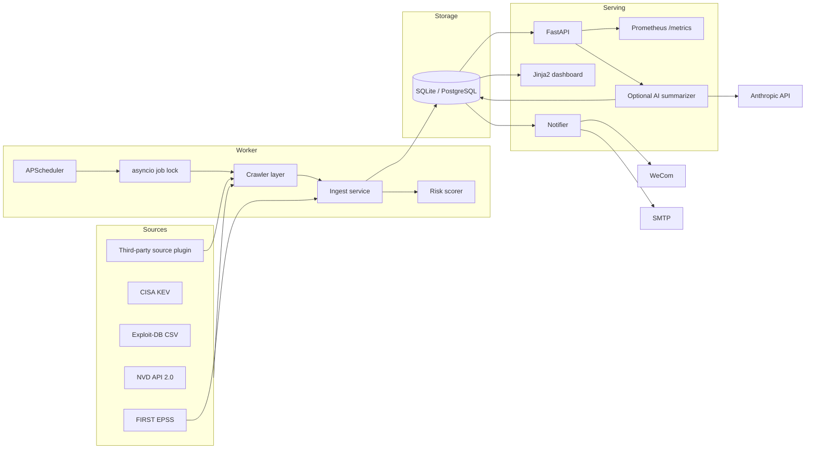
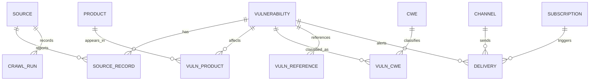

# VulPulse architecture

This document describes the design decisions behind VulPulse, the data flow
between components, and the trade-offs that matter when operating it.

## Goals and non-goals

**Goals**

- Collect public vulnerability metadata from multiple sources.
- Normalize everything into one CVE-centric model while keeping raw source
  records for auditability.
- Produce an explainable risk score and expose it through a stable API, a
  server-rendered dashboard, reports and alerts.
- Stay runnable as a single-node application with SQLite and Docker.
- Keep source adapters and presentation concerns replaceable through a small
  plugin boundary.

**Non-goals**

- Scanning hosts, exploiting vulnerabilities or providing proof-of-concept
  code.
- Replacing a full asset-management or SIEM product.
- Multi-tenant RBAC in the current release.

## Components

The API and scheduler are separate processes. The API never schedules crawls;
this prevents multiple API workers from duplicating source jobs. The worker
serializes jobs with an `asyncio.Lock` because SQLite has a single writer.

## Data model

The canonical entity is a vulnerability identified by a dedupe key, usually a
CVE. Source adapters emit `RawVuln` records; the normalizer selects fields and
the ingest service merges them into the canonical row.

- **Source records** keep the raw payload, source-specific ID, URL and fetch
  time. A normalized row can be traced back to every record that contributed to
  it.
- **Products** are `(vendor, product)` pairs; version ranges and CPEs live on
  the join table.
- **CWEs** are normalized identifiers; names are optional metadata.
- **Crawl runs** store checkpoints, status and counters. Checkpoints are used
  for incremental NVD windows.
- **Risk fields** are denormalized onto the vulnerability row so list and
  vendor queries stay index-friendly.

### Merge policy

The analyzer is responsible for conflict resolution. Ingest merges non-null
fields and keeps source records separately, so a field can be audited without
reconstructing the source. Re-running a crawl is idempotent: records are upserted
by dedupe key, not appended.

## Scheduling and concurrency

APScheduler runs in the worker process. Each schedule has a job ID, interval,
lookback and run-on-start flag. All jobs acquire one process-wide async lock, so
two sources cannot write simultaneously. This is intentionally conservative:
throughput is lower than a queue-based system, but a single-node SQLite
deployment remains correct without a broker.

When the worker starts, it discovers source plugins and creates one
`crawl:<name>` job per plugin. Built-in sources expose their intervals through
the same `plugin_schedule()` contract. A failing source is logged and isolated;
it does not stop the scheduler.

## Source plugins

A plugin is a `BaseSource` subclass exposed through the `vulpulse.sources`
entry point. The loader:

1. Registers built-in sources.
2. Loads entry points in sorted order.
3. Validates `PLUGIN_API_VERSION`, source name and schedule.
4. Registers the class in the source registry.
5. Records failures without aborting discovery.

Plugins run in-process and are trusted code. `VULPULSE_PLUGINS_ENABLED=false`
disables third-party entry points while keeping built-ins available.

## Optional AI summaries

AI summaries are disabled by default and are never generated by the scheduler.
An authenticated admin action (`vulpulse summarize` or the admin API) loads one
vulnerability, builds a bounded JSON payload, and sends it to Anthropic. The
summary, model and timestamp are cached on the vulnerability row; a refresh
must be explicit.

The system prompt treats the payload as untrusted data and forbids following
instructions found inside it. Source references and raw records are not sent,
input and output sizes are capped, and the dashboard renders the result as
escaped text. Enabling the feature is a deliberate data-processing decision:
the deployment sends selected metadata to a third party and incurs API cost.

## API and dashboard

FastAPI routers expose versioned JSON endpoints. Pydantic response models are
the API contract; the OpenAPI schema is enabled outside production and can be
forced on or off with `VULPULSE_DOCS_ENABLED`.

The dashboard is server-rendered Jinja2 with vendored Bootstrap and Chart.js,
so it works without a CDN. The relationship graph is rendered as deterministic
SVG on the server; the same graph data is available as JSON. This keeps the
frontend dependency-free and testable.

Authentication is a single API key:

- API clients send `X-API-Key`.
- The admin UI exchanges the key for a signed, HttpOnly session cookie.
- Sessions are bound to a fingerprint of the key and expire after eight hours.
- State-changing admin forms require a CSRF token.

## Security boundaries

| Boundary | Control |
|---|---|
| Public client → API | Per-IP rate limiting, bounded inputs, no error internals |
| Admin → UI/API | API key, session fingerprint, CSRF, login rate limiting |
| Crawler → sources | Rate limits, same-host HTTPS redirects, response caps |
| Notifier → WeCom/SMTP | HTTPS host allowlist, verified TLS, redacted errors |
| Plugin → process | Versioned contract, per-plugin failure isolation, opt-out |
| Admin → LLM provider | Opt-in, admin-only, bounded prompt, untrusted-data instruction |
| Container → host | Non-root user, pinned base image, persistent data volume |

See [SECURITY.md](../SECURITY.md) for the full threat model and residual risks.

## Observability

- Structured logs go through loguru; HTTP client request logs are suppressed to
  avoid leaking webhook keys.
- Every response has `X-Request-ID` and `X-Response-Time-ms`.
- `/metrics` exposes bounded-cardinality Prometheus counters and latency
  histograms. Route labels combine the top-level scope and route template, for
  example `api:/vulns` and `vulns:/vulns/{identifier}`.
- `/healthz` checks the database and is suitable for container health checks.

## Failure modes

- **Source outage**: crawl run is marked failed, the checkpoint is retained and
  the next scheduled run retries.
- **SQLite contention**: WAL, foreign keys and a 30-second busy timeout are
  enabled; the worker still serializes jobs to avoid write spikes.
- **Notification failure**: deliveries are deduplicated and retried up to
  `VULPULSE_NOTIFY_MAX_ATTEMPTS`; the error is stored on the delivery row.
- **Broken plugin**: recorded as a load failure and skipped; remaining sources
  continue.
- **API worker crash**: the scheduler is unaffected because it lives in its own
  process; the container restart policy restarts the API.

## Scaling path

The current design is optimized for one node. PostgreSQL is supported through
`asyncpg` and the Compose override; SQLite remains the default for small
deployments. If the deployment grows:

1. Use PostgreSQL and run migrations before starting the API/worker.
2. Run a queue (for example Redis or PostgreSQL-backed) instead of APScheduler
   so crawl jobs can run concurrently with per-source locks.
3. Move rate-limit state to a shared store if multiple API workers are exposed.
4. Add a reverse proxy for TLS, request limits, `/metrics` access control and
   admin network restrictions.
5. Keep the graph and dashboard server-rendered until traffic justifies a
   dedicated frontend.
